<p align="center">
  
</p>

# 🚀 Awesome Model Evaluation & LLM Benchmarking [](https://github.com/ishandutta2007/Awesome-Awesome-Awesome)

<p align="center">
  <a href="https://github.com/ishandutta2007/Awesome-Awesome-Awesome"></a>
  <a href="https://discord.gg/jc4xtF58Ve"></a>
  <a href="https://github.com/ishandutta2007/Awesome-Model-Evaluation-LLM-Benchmarking/stargazers"></a>
  <a href="https://github.com/ishandutta2007/Awesome-Model-Evaluation-LLM-Benchmarking/network/members"></a>
  <a href="https://github.com/ishandutta2007/Awesome-Model-Evaluation-LLM-Benchmarking/blob/main/LICENSE"></a>
  <a href="https://github.com/ishandutta2007"></a>
</p>

---

## 📌 Comprehensive Overview & Curated Directory

> **A rigorously curated ecosystem index of SaaS platforms, enterprise testbenches, and open-source frameworks for Large Language Model (LLM) evaluation, RAG validation, agent benchmarking, and continuous AI quality assurance.**

Whether assessing pre-trained foundation models, evaluating multi-hop Retrieval-Augmented Generation (RAG) pipelines, auditing prompt regressions in CI/CD, or observing live production multi-turn conversational agents, this repository tracks industry-standard tools, scoring frameworks, and testing methodologies.

---

## 📑 Table of Contents
- [🌐 Sector Overview & Market Dynamics](#-sector-overview--market-dynamics)
- [🏢 SaaS & Managed Enterprise Platforms](#-saas--managed-enterprise-platforms)
- [💻 Open-Source Frameworks & Benchmarking Tools](#-open-source-frameworks--benchmarking-tools)
- [🎯 Framework Selection Guide](#-framework-selection-guide)
- [📈 Star History](#-star-history)
- [🤝 How to Contribute](#-how-to-contribute)
- [💖 Support & Sponsorship](#-support--sponsorship)
- [📜 License](#-license)

---

## 🌐 Sector Overview & Market Dynamics

The AI evaluation and observability market is projected to expand from approximately **$1.8 billion in 2024 to over $8.5 billion by 2030**, clocking a compound annual growth rate (CAGR) exceeding **30%** as enterprise adoption shifts from pilot proof-of-concepts into safety-critical production deployments.

The sector exhibits **moderate fragmentation with rapid consolidation underway**; while foundational tracing and observability show strong winner-takes-most network effects centered around early platform incumbents (e.g., LangSmith, Arize Phoenix, Braintrust), the specialized niches—such as adversarial red-teaming, domain-specific regulatory compliance, deterministic RAG auditing, and offline synthetic test generation—remain intensely competitive and open to novel, specialized tools.

---

## 🏢 SaaS & Managed Enterprise Platforms

The table below ranks major commercial LLM evaluation and observability platforms sorted in descending order of market scale (estimated company valuation and total funding capitalization).

| Platform / Product | Category & Core Focus | Company Scale (Valuation / Funding) | Commercial Pricing | Free Tier / Trial Limits |
| :--- | :--- | :--- | :--- | :--- |
| **[LangSmith](https://www.langchain.com/langsmith)** | LLM tracing, dataset curation, prompt playground & offline evaluation | **$1.25B Valuation** ($125M+ raised) | Starts at **$39/seat/month** (Plus Tier; includes 10k traces/mo, extra traces at $0.005/trace) | **Free Forever Plan**: 1 user, up to 5,000 free traces per month, and 14 days data retention |
| **[Braintrust](https://www.braintrust.dev/)** | Enterprise evaluation engine, automated CI testing, proxy caching & tracing | **$500M Valuation** ($85M+ raised) | Starts at **$25/user/month** (Base Tier; plus metered API usage at $0.005/eval) | **Free Forever Plan**: 1 seat, up to 1,000 evaluation logs/traces per month with 14-day history |
| **[Arize AI](https://arize.com/)** | Full-stack AI observability, LLM tracing, drift evaluation & live monitoring | **$450M Valuation** ($61M+ raised) | Starts at **$50/seat/month** (Team Tier; additional usage at $0.0004/prediction trace) | **Free Forever Plan**: Up to 2 team seats and 25,000 prediction/trace events per month |
| **[Fiddler AI](https://www.fiddler.ai/)** | Model governance, AI safety firewall, guardrails & live trust monitoring | **$300M Valuation** ($45M+ raised) | Starts at **$1,500/month** (Production Starter tier billed annually) | **14-Day Free Trial**: Full enterprise access limited to 50,000 production evaluation events |
| **[Galileo AI](https://www.rungalileo.io/)** | Hallucination index, LLM-as-a-judge metrics, and automated prompt eval | **$150M Valuation** ($63M+ raised) | Starts at **$100/seat/month** (Pro Developer Tier; includes 20k processed evaluation calls) | **14-Day Free Trial**: Includes 10,000 free evaluation tokens/records across prompt test suites |
| **[Patronus AI](https://www.patronus.ai/)** | Enterprise LLM red teaming, hallucination detection & automated risk scoring | **$120M Valuation** ($20M+ raised) | Starts at **$499/month** (Startup Plan; includes 50k automated API evaluations) | **14-Day Free Trial**: Up to 5,000 automated prompt evaluation queries across standard models |
| **[Confident AI](https://www.confident-ai.com/)** | Cloud testing platform powered by DeepEval, CI/CD regression guardrails | **$30M Valuation** ($4.5M+ raised) | Starts at **$20/seat/month** (Developer Plan; includes 10k test results/mo) | **Free Forever Plan**: Up to 2,000 unit test evaluations per month and 1 project repository |
| **[Humanloop](https://humanloop.com/)** | Collaborative prompt engineering, human-in-the-loop review & evals | **$25M Valuation** ($5M+ raised) | Starts at **$45/seat/month** (Team Tier; includes 15k model interactions/mo) | **14-Day Free Trial**: Full platform features with an initial limit of 2,500 model generations |

---

## 💻 Open-Source Frameworks & Benchmarking Tools

A directory of top open-source repositories for local evaluation, test automation, academic benchmarks, and self-hosted LLM telemetry—**sorted in descending order by GitHub Stars_Count**.

| Open-Source Project | Stars_Count Badge | Primary Focus / Description | License |
| :--- | :--- | :--- | :--- |
| **[vLLM](https://github.com/vllm-project/vllm)** | [](https://github.com/vllm-project/vllm/stargazers) | High-throughput LLM serving engine featuring built-in benchmarking utilities for measuring inference latency, TTFT, token throughput, and concurrency bottlenecks | Apache-2.0 |
| **[LiteLLM](https://github.com/BerriAI/litellm)** | [](https://github.com/BerriAI/litellm/stargazers) | Unified proxy supporting 100+ LLMs with built-in evaluation plugins, latency tracking, cost tracking, and fallback benchmarking | Apache-2.0 |
| **[Langfuse](https://github.com/langfuse/langfuse)** | [](https://github.com/langfuse/langfuse/stargazers) | Open-source LLM engineering platform offering production tracing, dataset-driven evaluation, prompt management, and custom LLM score judges | MIT |
| **[promptfoo](https://github.com/promptfoo/promptfoo)** | [](https://github.com/promptfoo/promptfoo/stargazers) | CLI and library for prompt engineering, red teaming, LLM application security evaluation, output assertions, and automated CI test passes | MIT |
| **[Opik (Comet)](https://github.com/comet-ml/opik)** | [](https://github.com/comet-ml/opik/stargazers) | Modern open-source LLM evaluation, observability, and experiment tracking suite with native test runners and dataset versioning | Apache-2.0 |
| **[OpenAI Evals](https://github.com/openai/evals)** | [](https://github.com/openai/evals/stargazers) | Standard evaluation framework, extensible test registry, and automated grading harness for measuring model capabilities and prompt drift | MIT |
| **[DeepEval](https://github.com/confident-ai/deepeval)** | [](https://github.com/confident-ai/deepeval/stargazers) | Production pytest-style unit testing framework for LLMs and multi-turn agents, offering 50+ out-of-the-box metrics (G-Eval, Hallucination, Faithfulness) | Apache-2.0 |
| **[Ragas](https://github.com/explodinggradients/ragas)** | [](https://github.com/explodinggradients/ragas/stargazers) | Specialized evaluation framework for Retrieval Augmented Generation (RAG) pipelines; evaluates context precision, recall, faithfulness, and generates synthetic datasets | Apache-2.0 |
| **[lm-evaluation-harness](https://github.com/EleutherAI/lm-evaluation-harness)** | [](https://github.com/EleutherAI/lm-evaluation-harness/stargazers) | The gold standard open harness for base LLM benchmark replication (MMLU, GSM8K, ARC, HellaSwag, Winogrande) across multiple inference engines | MIT |
| **[Arize Phoenix](https://github.com/Arize-ai/phoenix)** | [](https://github.com/Arize-ai/phoenix/stargazers) | Self-hosted AI observability, OpenTelemetry-compliant tracing, automated evaluations, and visual clustering of embedding drifts | Elastic-2.0 |
| **[Cleanlab](https://github.com/cleanlab/cleanlab)** | [](https://github.com/cleanlab/cleanlab/stargazers) | Trustworthy AI framework to detect label errors, calculate LLM response trustworthiness scores, and audit hallucination risks in datasets | AGPL-3.0 |
| **[OpenCompass](https://github.com/open-compass/opencompass)** | [](https://github.com/open-compass/opencompass/stargazers) | Comprehensive evaluation platform for foundation models, multimodal models, and specialized agents with over 100 benchmark datasets | Apache-2.0 |
| **[whichllm](https://github.com/Andyyyy64/whichllm)** | [](https://github.com/Andyyyy64/whichllm/stargazers) | Hardware-aware LLM recommendation and benchmarking tool to discover models that run at peak efficiency on local GPU and CPU constraints | MIT |
| **[TruLens](https://github.com/truera/trulens)** | [](https://github.com/truera/trulens/stargazers) | Instrumentation and evaluation library providing RAG Triad feedback functions (groundedness, context relevance, answer relevance) | MIT |
| **[Inspect AI](https://github.com/UKGovernmentBEIS/inspect_ai)** | [](https://github.com/UKGovernmentBEIS/inspect_ai/stargazers) | Framework created by the UK AI Safety Institute for rigorous evaluation of frontier model safety, cybersecurity capabilities, and autonomous agents | MIT |
| **[HELM](https://github.com/stanford-crfm/helm)** | [](https://github.com/stanford-crfm/helm/stargazers) | Holistic Evaluation of Language Models from Stanford CRFM; standardized, multi-metric scenario evaluations across commercial and open weights | Apache-2.0 |
| **[Lighteval](https://github.com/huggingface/lighteval)** | [](https://github.com/huggingface/lighteval/stargazers) | Lightweight, performant model evaluation toolkit developed by Hugging Face powering the Open LLM Leaderboard v2 | Apache-2.0 |
| **[AlpacaEval](https://github.com/tatsu-lab/alpaca_eval)** | [](https://github.com/tatsu-lab/alpaca_eval/stargazers) | Fast, automated, and low-cost benchmark based on LLM-as-a-judge for testing instruction-following models against standard reference answers | Apache-2.0 |
| **[EvalPlus](https://github.com/evalplus/evalplus)** | [](https://github.com/evalplus/evalplus/stargazers) | Rigorous code generation evaluation framework for LLMs (augmenting HumanEval+ and MBPP+ with thousands of test cases) | Apache-2.0 |
| **[HarmBench](https://github.com/centerforaisafety/harmbench)** | [](https://github.com/centerforaisafety/harmbench/stargazers) | Standardized evaluation framework for automated red teaming, adversarial prompt testing, and AI safety benchmark comparisons | MIT |

---

## 🎯 Framework Selection Guide

Depending on your architecture stage, here is the recommended tech stack composition:

```
[ Developer CI/CD Prompt Tests ]
       │
       ▼
  promptfoo / DeepEval  ──(Unit tests & Red Teaming)──► Pass / Fail Build Gate
       │
       ▼
[ Retrieval & RAG Validation ]
       │
       ▼
     Ragas / TruLens    ──(Context Recall, Groundedness, Faithfulness Scores)
       │
       ▼
[ Production Tracing & Observability ]
       │
       ▼
  Langfuse / Phoenix    ──(Live User Traces, Drift Monitoring & Human Feedback)
       │
       ▼
[ Foundation Model Selection & Auditing ]
       │
       ▼
  lm-eval / OpenCompass ──(Base Model Swaps, MMLU/GSM8K Academic Benchmarking)
```

- **Unit Testing & CI/CD**: Use **DeepEval** (if you love `pytest`) or **promptfoo** (if you prefer declarative YAML configs and security red-teaming).
- **RAG Triad Analysis**: Use **Ragas** or **TruLens** for rigorous measuring of context precision, factual grounding, and semantic answer similarity.
- **Self-Hosted Tracing & Observability**: Deploy **Langfuse** or **Arize Phoenix** for OTEL-compliant trace capture and evaluation dashboards.
- **Frontier & Base Model Benchmarking**: Execute **lm-evaluation-harness**, **Inspect AI**, or **OpenCompass** across standard benchmarks.
- **Hardware-Constrained Deployment**: Use **whichllm** to identify which models execute at full speed on specific GPU/VRAM hardware limits.

---

## 📈 Star History

[](https://star-history.dera.page/#ishandutta2007/Awesome-Model-Evaluation-LLM-Benchmarking&type=date&legend=top-left)
[](https://www.star-history.com/#ishandutta2007/Awesome-Model-Evaluation-LLM-Benchmarking&type=date&legend=top-left)

---

## 🤝 How to Contribute

Contributions to expand and update this directory are warmly welcome!
1. Fork this repository.
2. Create a new branch: `git checkout -b feature/add-eval-tool`.
3. Add your SaaS product or open-source repo ensuring factual pricing, exact company metrics, or accurate Stars_Badges.
4. Verify all Markdown formatting and tables render cleanly.
5. Submit a descriptive Pull Request!

---

## 💖 Support & Sponsorship

Thank you for visiting and supporting the **Awesome Model Evaluation & LLM Benchmarking** repository! 🌟

If you find this curated directory helpful for your AI research, production LLM systems, or benchmarking work, please consider:
- ⭐ **Starring this repository** on GitHub to help others discover it
- 🍴 **Forking it** and contributing additions or updates
- 📢 **Sharing it** with your team, fellow AI engineers, and community networks

If you'd like to further support ongoing maintenance, updates, and open-source tooling, consider sponsoring:

👉 **[Sponsor on GitHub Sponsor Dashboard](https://github.com/sponsors/ishandutta2007)** ☕

---

## 📜 License

This work is licensed under the [MIT License](LICENSE).
